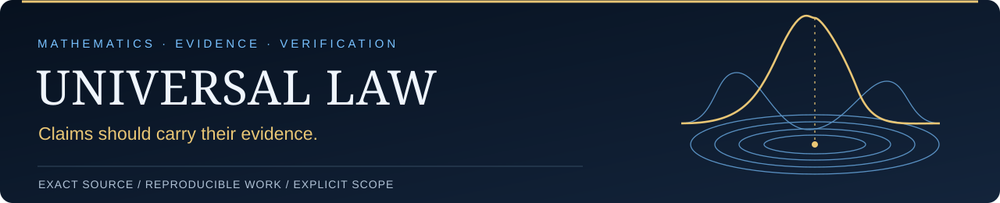

# Universal Law

**The mathematics of random landscapes, critical points, and the features that persist.**

Imagine lowering a waterline over a landscape. Peaks emerge, islands grow, and connections form. This research studies how those changes behave in Gaussian random fields—and which statements we can establish under precise assumptions.

**[Explore the mathematics →](https://d6g8k5htny-coder.github.io/main/site/)**

| Start with… | What you will find |
|---|---|
| [Interactive examples](https://d6g8k5htny-coder.github.io/main/site/explore.html) | Change a peak, bring two points closer, or test a tiny partition problem. No setup required. |
| [A research reading path](https://d6g8k5htny-coder.github.io/main/site/research.html) | The questions, selected arguments, and their conditions in plain language. |
| [Reproduce one calculation](https://d6g8k5htny-coder.github.io/main/site/reproduce.html) | A pinned exact coefficient example, standard-library commands and expected output. |
| [Cite a source](https://d6g8k5htny-coder.github.io/main/site/cite.html) | Citation metadata and an offline tool for immutable source references. |
| [The technical library](https://d6g8k5htny-coder.github.io/main/site/workspace.html#inventory) | Searchable full texts, exact source identities, and reproducibility records. |

The interactive models teach defined examples. Results retain the hypotheses and review scope of their sources. This is research in progress; an illustration or passing computation is not a theorem.

## Read more deeply

- [Research guide](docs/RESEARCH_INDEX.md) — start with the topic-by-topic route to sources, review records, successor results and remaining work.
- [Full mathematics](docs/PUBLIC_MATHEMATICS.md) — public proof texts, repaired reading contracts and exact-source provenance.
- [Research status snapshot](STATUS.md) — claims and reviews recorded on 29 September 2026; its source date is preserved, so use the guide for the current reading route.
- [Proof index in Math-](https://github.com/d6g8k5htny-coder/Math-/blob/main/PROOF_INDEX.md) — selected 26–29 September coverage with scoped later reading guidance. The [October reachability supplement](https://github.com/d6g8k5htny-coder/Math-/blob/79cb314d5b9f6b8b410bfd0df200414314f6b8c7/docs/integration/2026-10-02-proof-reachability.md) records availability through its 3 October cut, not current acceptance; the guide links later work by source and scope.
- [Source records and historical exhibits](https://d6g8k5htny-coder.github.io/main/site/museum.html) — fixed snapshots with traceable evidence.
- [Formal verification](docs/FORMAL_VERIFICATION.md) — what the Lean checks establish and what remains outside them.

The public display and the current proof repository may use different source dates. Each technical view names its snapshot; source dates and review labels retain their stated scope, and newer reading routes do not transfer acceptance. The [public source inventory](docs/public-math/sources.json) preserves 2,138 frozen file identities, not a theorem count.

<strong>For researchers and contributors</strong>

The [research workspace](https://d6g8k5htny-coder.github.io/main/site/workspace.html) contains exact coefficient endpoints, dated status records and source lookup. The [workspace guide](docs/WORKSPACE.md) explains execution, repositories and coordination. [Contribution options](CONTRIBUTING.md) remain open, from improving an explanation to submitting a source-bound result.

| Repository | Role |
|---|---|
| [main](https://github.com/d6g8k5htny-coder/main) | Public reading experience and shared project guidance |
| [Math-](https://github.com/d6g8k5htny-coder/Math-) | Proofs, mathematical calculations, tests and reviews |
| [query-](https://github.com/d6g8k5htny-coder/query-) | Read-only exact-source lookup |
| [Universal-Law-Workspace](https://github.com/d6g8k5htny-coder/Universal-Law-Workspace) | Repository map |

[Reproduction guide](docs/REPRODUCE.md) · [Agent entry](AGENTS.md) · [Current workflow](governance/OP-WORKFLOW-20260930.md) · [Active coordination board, main #619](https://github.com/d6g8k5htny-coder/main/issues/619) · [Prior board #539 (history)](https://github.com/d6g8k5htny-coder/main/issues/539) · [Prior board #475 (history)](https://github.com/d6g8k5htny-coder/main/issues/475) · [Prior board #419 (history)](https://github.com/d6g8k5htny-coder/main/issues/419) · [Prior board #307 (history)](https://github.com/d6g8k5htny-coder/main/issues/307) · [Historical #229 working guidance](https://github.com/d6g8k5htny-coder/main/issues/229#issuecomment-6038554880) · [Architecture discussion, main #666](https://github.com/d6g8k5htny-coder/main/issues/666) · [Closure-evidence decision record, main #275](https://github.com/d6g8k5htny-coder/main/issues/275)

Released under the [MIT License](LICENSE). [Citation metadata](CITATION.cff).
