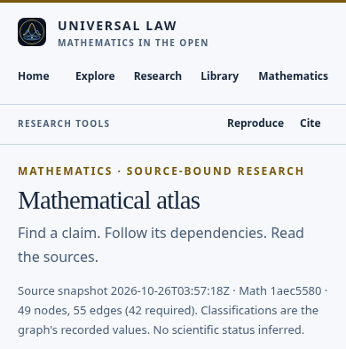
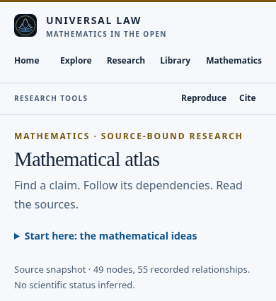

# Approachable Atlas reader

The Atlas offers a short, optional starting guide to landscapes, thresholds, components, persistence, hypotheses and recorded dependency arrows. Its main view leads with navigation and a concise observation summary. **Source snapshot and reproducibility**, beside the existing source actions below the workbench, retains the entire original observation, complete Main/Math revisions and exact graph link. Native disclosure keyboard behavior and static introductory reading need no extra library. Scope/source links, missing or adverse formal evidence, source refusal and failures remain explicit.

This release also repairs the existing low-contrast secondary text in the optional3D accessible relationship list. Inherited button ink replaces the muted color; literal metadata and scientific records are unchanged. Source/head/audit/CI/publication are separate qualifications. No new formal connection or theorem coverage is asserted.

## Before and after

| Phone, light | Phone, light after |
|---|---|
|  |  |

[Desktop before](visuals/before-1200-dark.png) · [desktop after](visuals/after-final-1200-dark.png) · [introductory guide](visuals/guide-390-light.png). All twelve PNGs are browser-native clipped/element screenshots; no edited or generated pixels. Only the upper page/educational guide is public here; original full reader screenshots, source fixture and audit DOM/AX/axe records remain privately preserved.

The first implementation passed functional checks but added116px before phone search. That layout was retained as a failed usability candidate. Moving provenance to source actions and making the guide compact reduced the final cost to32px on phones/31px on desktop. The guide remains easy to find; readers can search without reading it. The public source toggle is below the working Atlas, so discovering it requires scrolling. No user study or universal usability claim was made.

## Measured evidence

Exact dataset:49nodes/55recorded relationships,1,671,822-byte frozen captured source. [Inputs and exact code identities](SOURCE-IDENTITIES.json), [raw engineering measurements](MEASUREMENTS.json), and [before](BEFORE-JOURNEYS.json)/[after](AFTER-JOURNEYS.json) use a byte-identical six-case driver. Baseline0/6 expected absent new features; final6/6, plus the new refused-provenance-history case1/1. This is not a claim that the old reader was generally broken.

Four page-ready observations per side, sandboxed Chromium154/Linux/DPR1/software WebGL in one shared environment: median349→373ms; new disclosure13.5ms. Page-inclusive decoded load increases4,151B (HTML+2,470B; other resources+1,681B). No new production network dependency. Parallel observations can affect timing; no speedup, statistical latency, physical-device, Safari or larger-dataset claim. Current limits include dense/culling3D labels and existing keyboard/list/static alternatives.

## Accessibility and verification

[Structured accessibility audit](ACCESSIBILITY.md) · [all55 A/AA criterion dispositions](WCAG-CRITERIA.md). Independent implementation-side observer OpenAI/Codex, same provider/shared account/org0. The audit found original dark3D metadata contrast1.1097:1. A focused regression also reproduced light1.9803:1. Single-property repair: light13.2187:1/dark9.9395:1; separately identified auditor recheck confirms both sampled themes, with zero scoped contrast axe violations/incomplete results. The original failed sources/results remain preserved.

The audit records25partial observations,1partial criterion with sampled repair,13not-applicable within sampled content,7NOT_TESTED and9manual/AT/further-review items. Existing speech-status reading, View sensitivity and count-announcement findings remain open in their separately owned repair/qualification lane. Actual speech tools were unavailable; browser AX/axe is not spoken AT. Footer hit-area overlap remains a usability issue; the three sampled functions have verified equivalent same-page controls under2.5.8. No full WCAG or whole-site accessibility claim follows.

[Verification scopes/results](VERIFICATION.json):7focused,2contrast,16real spatial including two actualCANVAS picks/context loss/fallback/history,4fullgraph-label,10refusal,4retained-formal-reader and39official-reader cases pass within their recorded versions. All14prescribed local command groups exit0, including source/site generation checks, asset release and formal required-check controls; [commands](CHECKS.json). Canonical asset token `cf9f17939e50545a6bd19da777fbc38bf794981cca246e82956942abd97e83fc`.

Reproduce with the exact privately preserved `publication/current.json`: copy the committed site to a new destination, run `python -B tools/current_site_build.py --site DEST --payload EXACT_CURRENT_JSON`, then `python -B tools/atlas_approachable_browser_check.py --site DEST --output NEW_OUTPUT` and `python -B tools/atlas_accessible_list_browser_check.py --site DEST --output ANOTHER_NEW_OUTPUT`. Run the other prescribed commands from [the site guide](../../site/README.md#verify-the-reader-experience). Axe4.10.3/MPL-2.0 was audit-only and is not a new shipped dependency; tarball/engine integrity and all originals are privately retained.

## Custody and delivery boundaries

All original tracked site bytes at Main8fb04 and actually captured publication inputs were independently downloaded and verified before replacements:258files/12,012,387B/SHA25689d6355eaab9e16544634d5d3a0d9cccbd6b4cc5534444b4e652aa19d3edc2b4, privateDrive1c7sE3T7et2xA2R8g4Ofy43nVmtHHlh7W. Original157head/PR body retained before refinement:11files/347,363B/SHA27acb375e501f3adfaf586301fdbb32215a3f49282d278931d1e8e95817779cc, privateDrive1KS1I58vOtf_vO5zEZbsUN-hcOrZv8XXP, independently verified. Earlier archives/history remain; no Drive deletion/overwrite/sharing change. Final head custody, actual separate review/integration/current checks and deployed readback are recorded on PR651, not inferred from these local observations. Current CI binary artifact denial remains stopped; logs/metadata are not original-ZIP custody.

Next highest-value increment: complete the already routed screen-reader source repair and actual frozen-version speech qualification, then test the entry guide with readers unfamiliar with the research. Formal-source alignment work stays with its current owners; its outcome must be verified before any future mapping update.
