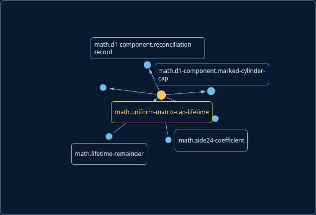
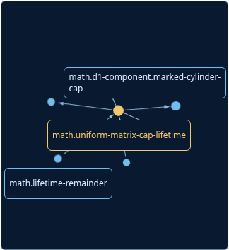
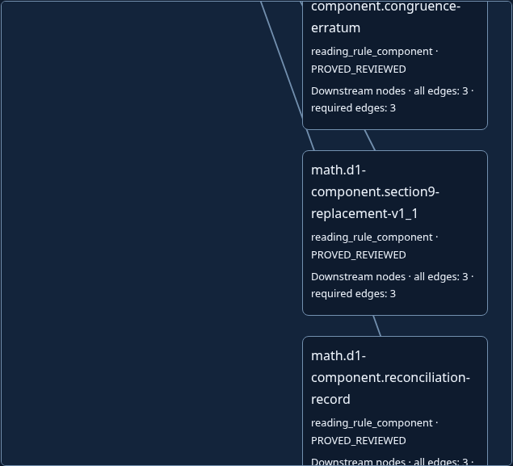
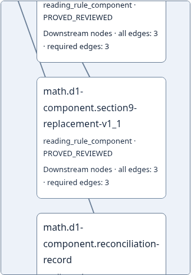

# Hosted Atlas rendering admission

The existing hosted current-site runner now requires actual optional 3D rendering and real sphere picking, alongside its existing source, static reading and accessibility assertions. This closes a demonstrated admission gap: the previous 39 cases passed a source fixture whose WebGL failure detached the focused inspector.

This is an engineering verification contribution to [the shared CBZ consolidation](https://github.com/d6g8k5htny-coder/main/issues/684). It adds no mathematical proof, claim-to-formal mapping, scientific acceptance, production dependency or UI change. Canonical baseline documents and serial integration remain in that existing lane. CBZ-0 is not established by this report.

## Source and execution identity

The public dataset is Main `4ef1867175dbe1072a54a02e95f80c4e2c70a4ff` (tree `005e7fb08659f23485587b7201779e9d30b7ccd1`) and Math `8151f592918a845bf19eb8eafaf8444540a32734` (tree `b887218ed5cda9b023a83fceada9afa2cc38c982`). It contains 49 nodes, 55 directed typed edges (42 required), 108 excerpts and a 1,935,202-byte payload. Payload SHA-256: `3ce5fe0ad8698a9ff20f749a881232bff28bfc3ddeb06b974b4264bd3b51ccc9`.

The prescribed two-pass source generation reproduced all 1,733 published files / 57,307,161 bytes and artifact fingerprint `4ce22af85f438cccf434d17265c886320a4ebad3097d0a431da61e64ff89ddd7`; see [artifact reproduction](artifact-reproduction.json). This uses original public source history and the admitted observation, not a CI binary artifact. [The execution binding](integrated45-binding.json) identifies the modified operator/helper bytes separately from the unchanged source fixture. Its `checked_commit` is the source fixture revision; it is not a claim the modified operator was a clean 4ef checkout.

Actual executor: Linux, Python 3.12.14, Playwright 1.62.0, Chromium 154.0.8037.57, sandbox enabled, ANGLE/Vulkan SwiftShader, device scale1 and reduced motion. Viewports are 1200×900 and 390×900 for the added positive paths. No install, protection/CSP change, denied artifact retrieval or access-control workaround was used.

## Observed admission and adverse controls

| Exact run | Observed result | Meaning |
|---|---|---|
| [Original runner / correct source](baseline39.json) | 39/39 pass | Existing reader journeys remain exercised |
| [Original runner / E1 focus mutation](e1-original39.json) | 39/39 pass | Demonstrated continuing admission gap |
| [Integrated runner / correct source](integrated45.json) | 45/45 pass | Original39 plus six real-renderer/fallback/refusal cases |
| [Integrated runner / E1 mutation](integrated-e1-exit1.json) | 43/45 pass, process1 | Both positive paths reject detached original SUMMARY |
| [Integrated runner / blocked Three](integrated-blocked-three-exit1.json) | 43/45 pass, process1 | Both positives explicitly require rendering; useful fallback is insufficient for positive admission |

The E1 fixture changes only the failure callback from graph-only rendering to full inspector rendering, then uses the canonical asset-release tool; [mutation identity](e1-control-binding.json) is retained. Standalone helper controls independently show correct6/6 and both adverse positive cases rejected. The integrated control process-exit qualification is recorded in [the harness correction](control-harness-correction.json): an initial local wrapper discarded `main()`'s returned1. Those original reports remain as failed-case observations, not successful process-failure admission. The corrected wrapper propagates `SystemExit(main())` was rerun separately: both fresh45-case reports retain exactly the two expected positive failures and both processes exited1. [Observed exit outcomes](control-exit-outcomes.json) and [the executed corrected driver](executed-control-driver.py) distinguish them from the original [E1](integrated-e1.json) and [blocked-Three](integrated-blocked-three.json) exit0 wrapper trials.

Assertions inspect actual canvas pixels and source-derived sphere coordinates before a real mouse click, exact inspector metadata/source href, directed relationship types, Share/reload/Back/Forward, reduced-motion on-demand frames, and actual `WEBGL_lose_context`. The original focused/open/connected SUMMARY and its original native Tab successor must survive; desktop requires PRE, while expanded narrow reading natively proceeds to Share. Restored Graph cards must not overlap and a real metadata mouse click must select the exact expected source node.

Four pure connected-neighborhood tests and the new missing-source/executable failure contract join the unchanged existing three contract tests: **8 tests pass normally and under optimized Python3.11 `-S`**, with raw logs retained. Asset-release tests: **46 pass**. Canonical asset generation and `--check` both exited0. All other prescribed public-shop local commands exited0; [exact command results/logs](required-site-checks/RESULTS.json) and [the Node log](required-site-node.log) retain counts and any fixture-dependent skips. The museum checker performs the documented fixture-backed replay; a standalone missing-fixture skip is not a full execution claim. Original malformed/missing-source refusal is retained; a requested executable is distinguished from actual launched browser evidence.

## Measurements and visual observations

These are single engineering samples on a shared software renderer, including automation overhead, not latency guarantees or a speedup comparison. The shipped UI/source bytes are unchanged by this verification patch. [Raw measurements](measurements.json) bind the dataset and actual GL identity.

| Positive journey | Activate to ready | Reported frame | Real mouse pick to inspector | Context-loss response |
|---|---:|---:|---:|---:|
| Desktop, 7-node scene | 224ms | 40.5ms | 79ms | 47ms |
| Narrow, 7-node scene | 273ms | 4.1ms | 37ms | 36ms |

The six new case bodies total about8.6s in this observation; this excludes original39, browser launch and report serialization. Reduced-motion keyboard changes draw and then settle without an idle animation loop. This is not a benchmark of the existing150-node limit, full49-node rendering, physical GPU, real touch or a network-constrained public reader.









Visual inspection found a readable selected label and directed arrows in the bounded scene. Some surrounding labels are culled/occluded; the inspector and accessible relationship list remain the complete reading routes. Restored cards are separated, and narrow cards wrap long identifiers. These images compare rendering and recovery states of the same shipped product, not a claimed UI redesign. Historical before/after product screenshots remain in the earlier release records.

## Tool registry handoff and reproduction

`tools/atlas_spatial_admission.py` exports `exercise_spatial_admission(browser, origin, output, report, data, expect)`. It appends exactly six cases, owns/closes its contexts and leaves the caller's browser alive. Imports require only stdlib; browser objects come from the existing caller. `tools/current_site_browser_check.py` calls it and adds optional `--browser`; the default hosted packaged Chrome channel remains. The explicit software-WebGL flag matches the existing spatial operator. Existing Playwright1.62.0 and vendored MIT Three0.160.0 remain pinned; no dependency/license changed.

Run from a coherent generated checkout:

```sh
python3.11 -B -S -m unittest tests.test_atlas_hosted_browser_contract tests.test_atlas_spatial_admission tests.test_current_site_browser_contract -v
python3.11 -B -O -S -m unittest tests.test_atlas_hosted_browser_contract tests.test_atlas_spatial_admission tests.test_current_site_browser_contract -v
python3 -B tools/current_site_browser_check.py --browser /path/to/chromium --output NEW_DIRECTORY
python3 -B tools/site_asset_release.py
python3 -B tools/site_asset_release.py --check
```

Hosted CI omits `--browser` and uses its packaged Chrome. Exact-source regeneration commands remain in [the site guide](../../site/README.md). This finished self-contained helper serves CBZ criteria5/9 and gateG5; the canonical integrator must register it and the modified runner in GOVERNANCE/TOOLING/STATUS. It does not certify Layer A or replace formal gates.

Limitations: headless Chromium and software WebGL only; palette/reset-camera/raster oracles intentionally bind the current presentation; no physical touch, hardware GPU, other browser, spoken assistive technology or full WCAG audit. No new formal connection is established. Acquisition, review, kernel checking, alignment and scientific acceptance remain distinct; absent mappings stay absent. Global baseline gates, exact integration/deployment revision and cold-start replay require their own observed runs.

Actual authors: OpenAI/Codex parent and Kepler for the helper; prior source/review exposure is explicit, organizational-independence credit0, scientific effect NONE. [Evidence file hashes](EVIDENCE.json) preserve original run identity.

## Native attempt1 and completeness-contract repair

At submitted head `11cc83c4da34ddda66eba1e5193862ff2f805e16`, the native browser step also printed **45/45 PASS**. Its following report-preservation step failed: the existing workflow validator required exactly39 cases. [Native identity and plain diagnostic](native-attempt1.json) retain this split; no native report payload was acquired or decoded. Direct execution of that validator on the actual local45 report reproduced the error (five tests:2failures/2errors/1pass). Requiring exactly45 fixes the mismatch and rejects an old39 report; all previous shape, type, digest, checkout, duplicate-key and finite-value refusals remain. A complete43-pass/2-fail report remains failure evidence rather than being relabelled a browser success. The13 focused controls now pass normally and optimized. All caps, original reports, artifact retention, browser assertions and workflow triggers remain. Corrected-head native checks still require their own observation.

## Geometry admission strengthened after peer counterexample

[Bounded review](geometry-strengthening/review-FINDINGS.md) found that the first helper reselected Graph before checking geometry, triggering a render that masked a removed failure-time reflow callback. The independent full45 entry reproduced that false admission:45/45 passed on the no-reflow mutation. The fixed helper inspects an already visible Graph without selecting it again, and explicitly records separate mobile reader-to-Browse and List-to-Graph actions. New source-bound runs: correct45/45/exit0, no-reflow42/45/exit1 with the three expected visible-Graph overlap failures, E1 focus43/45/exit1, and blockedThree43/45/exit1. All13 focused controls pass normally and optimized. [Exact new results/source/driver identities](geometry-strengthening/RESULTS.json) and the raw reports preserve the earlier false admission without relabelling it. The original performance samples above belong to the first helper; they are not rebound to this strengthened source. Production UI/source assets are unchanged. Corrected-head native CI remains a separate required observation.
