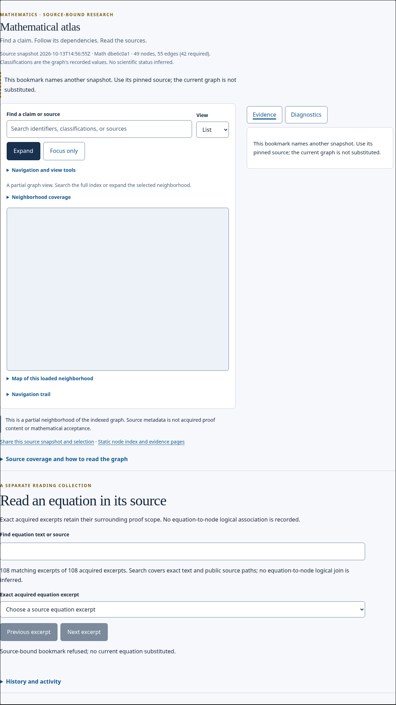
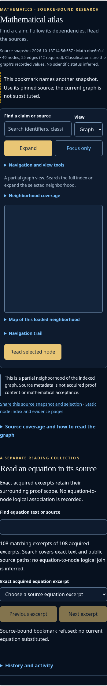

# Preserve refused Atlas source identity

Engineering-only repair: [PR616](https://github.com/d6g8k5htny-coder/main/pull/616), canonical [pickup](https://github.com/d6g8k5htny-coder/main/issues/388#issuecomment-6403171202), coordinator [offer](https://github.com/d6g8k5htny-coder/main/issues/388#issuecomment-6403115873). This is the pre-existing [controller follow-up](https://github.com/d6g8k5htny-coder/main/issues/388#issuecomment-6403025683), separate from the optional3D implementation. The PR's current disposition controls review and integration; this report does not grant merge clearance or scientific acceptance.

## What changes for a reader

A bookmark that requests unavailable/different Math or Main source pins remains refused when the reader changes Graph/List, copies Share, opens that link, reloads, or uses Back/Forward. The requested pins and node remain identical, including duplicated source parameters. The chosen layout and unrelated address fields remain available. Initial Share now points to that refused identity rather than a generic current view.

The source-adoption boundary remains explicit: selecting a current diagnostic claim deliberately adopts the actual current Math/Main pins. Back restores the original refusal; Forward restores the deliberately selected current claim. No mathematical evidence is inferred from either action.

Before, View→List rewrote the address/Share link to current pins while the visible page still said refused. Reload then admitted current data. This contradiction now stays closed: `urlState` refuses to serialize current-source defaults whenever `state.error` exists; only the layout choice is serialized separately. Every caller gets the same guard, rather than relying on each event handler to remember it. Explicit current-node selection already clears refusal before adopting its actual pins.

Associated defect: Expand was enabled during refusal but read `displayed.ids` before a graph window existed, raising a TypeError. It now returns while refused; admitted expansion is unchanged. No source schema, data, classification, graph edge, formal mapping or acceptance authority changes.

## Causal and real-browser evidence

- Clean baseline:114/114 original controller tests pass on Main105ced0b.
- New controller regressions: original source fails the view/source invariant and initial Share assertion; explicit diagnostic adoption passes. After the serialization repair all117 assertion tests passed, but an asynchronous Expand TypeError remained. That genuine failed run is retained. The one-line refused Expand guard makes the entire117/117 run pass with no asynchronous errors.
- Real browser baseline:8/8 pin-identity journeys fail on Main105; two independent controls (whole-payload byte refusal and no-JS static reading) pass. Raw mode is explicitly `baseline-observation`, not acceptance.
- Repaired committed source51e53cb5:10/10 actual sandboxed Chromium browser cases pass. The base-only current-Main refresh changes no owned UI/test/tool bodies; refreshed117-node and10-browser runs also pass. `SOURCE.json` records both revisions.
- Wrong Math pin, wrong Main pin, repeated pins and malformed pins each run at1200px/light and390px/dark. They cover initial Share, Graph/List, copied Share, reload, ordinary layout history, Back/Forward, explicit current-node adoption and return to refusal. Unrelated query values remain intact. Every refused graph/list has zero current node buttons.
- All14 prescribed site/current/formal-contract command groups pass; complete commands and original outputs are in `checks/`. These are engineering checks, not execution of new mathematical proof work.

A browser-driver correction is preserved honestly: the first candidate replay tried the mobile-only “Read selected node” button on desktop and timed out in four cases after the pin checks passed. It now uses the actual visible Evidence tab on desktop and the reader button on mobile. No forced hidden click or product change was used to quiet that driver failure. Original `after/` remains, alongside successful `after-corrected/` and committed/refreshed results.

## Composition with the immersive release

A separate detached checkout of613 head42c60df7 received the exact controller patch and regressions. Its canonical asset release/check passed,120 Node tests passed, all10 refusal cases passed, and all16 actual spatial cases passed. The613 branch/ref was not edited. `composition-refusal.json`, `composition-spatial.json`, controller.patch and source/test logs retain this evidence. The report's `checked_commit=42c60df7` identifies the detached starting commit; it is explicitly a working-tree composition with the declared patch, not a claim that the unmodified613 commit contains this repair.

This is useful pre-integration evidence, not a protected merge candidate on a future Main. The final integrator must reconcile actual landing order/current head/base, compare product bodies and regenerate only canonical importer keys, then qualify that exact composition. Existing501 acquisition/transition work, held399 source,613's review and separate reader-polish paths remain untouched.

## Screenshots and usability

| Original refused view after the faulty view change | Corrected refused view after the same action |
|---|---|
|  |  |
|  |  |

The page already displayed a clear refusal in both versions. The actual defect was the contradictory address/Share destination, so screenshots alone cannot prove the repair. Each raw browser report retains the requested URL, resulting URL, Share href, view, refusal text and node count at each checkpoint. Those states show that reload/navigation now preserve the reader's chosen revision rather than silently switching it. The error text remains legible on the tested narrow/dark and desktop/light layouts. There is no visual restyle or load-speed improvement claim.

## Reproduce

From a Git checkout, with Playwright1.62.0 and the explicitly selected packaged Chromium executable:

```sh
node --test tests/test_current_site.mjs
python -B tools/atlas_refusal_browser_check.py --output /tmp/atlas-refusal
python -B tools/site_asset_release.py --check
```

The browser tool accepts `--site` for a separately generated/composed site and `--browser` for the actual executable. `--observe` records a known baseline with failed assertions and is not acceptance. Browser checks enable the sandbox. Environment: Linux, Chromium154.0.8037.57, reduced motion, desktop1200×900 and narrow390×900. The source dataset is the unchanged committed historical current.json,49 nodes/55 edges; its stale observation warning remains. Physical Safari/touch and spoken assistive technology are not established by this repair.

## Preservation and boundaries

Before edits,258 original site/public-math/test paths at105ced0b were archived with source revision, lengths and hashes; the Drive ZIP was independently downloaded, whole-byte/member/CRC verified:2,586,169bytes, SHA256ae7a375fbcaa5153f1a25dc823eb826abd792a4b5df07ea7a0e655e8cb6648c8. Existing access levels are preserved. No GitHub file deletion, Drive deletion/overwrite or sharing change. No graph/current.json/formal/status/scientific evidence bytes are changed. Mainb8e's39 incoming historical source files are preserved by the base-only merge, not edited or executed here.

Author: this OpenAI/Codex immersive-interface invocation; author tests are not nonauthor review. Current-family engineering review may be by a separate same-family reviewer under Main105's owner decision; scientific review remains a different-family scope and is not undertaken here. Existing formal mappings remain missing; no theorem, kernel alignment or scientific status is promoted by this navigation fix.
