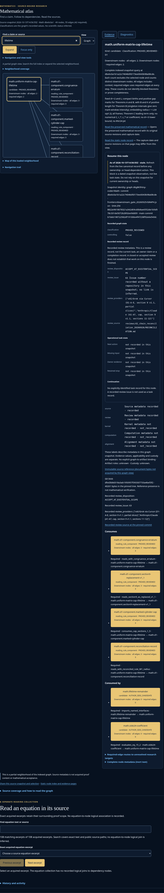
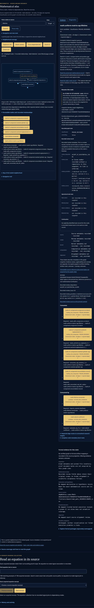
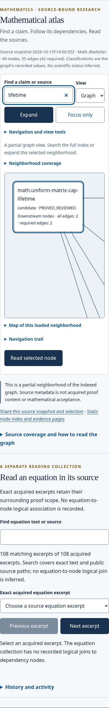
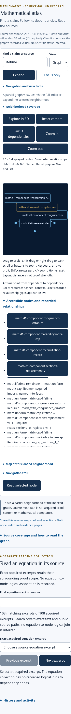

# Observed performance and visual comparison

Source implementation: `f6798c52fcd95a5978755fa9ce9d4772ac9fbe30`. Single before/after runs over the unchanged49-node/55-edge committed graph, local HTTP, Chromium154/SwiftShader on Linux. The before and after runs occurred at different times; final checks ran alongside other validation, so these are observed costs, not a controlled speedup claim. No CPU/network throttling. Search numbers include a deliberate100ms settle.

| Viewport | Before load | After load | Before search | After search | Optional3D activation |
|---|---:|---:|---:|---:|---:|
| 1200×900 | 283.1ms | 306.1ms | 150.5ms | 153.8ms | 221.0ms |
| 390×844 | 255.9ms | 476.6ms | 159.4ms | 150.5ms | 248.1ms |

No startup speed improvement is claimed. The adapter and CSS add about14KB decoded before3D. Three.js adds1,272,972 decoded bytes only after activation; the browser report verifies it is absent before3D. Local fetch duration cannot predict a mobile network download.

For the entire49-node/55-edge graph,12 keyboard-orbit samples produced:

| Measured interval | Minimum | Median | Maximum |
|---|---:|---:|---:|
| CPU draw submission + label projection | 2.70ms | 6.20ms | 29.30ms |
| Keyboard event → observed rendered frame | 11.20ms | 22.85ms | 93.64ms |

CPU draw time is wall time for JS rendering submission and DOM-label projection, **not GPU completion time or FPS**. The keyboard measurement includes Playwright dispatch/polling overhead. No sustained animation runs; idle/hidden frame counters remain unchanged. These samples do not establish performance for150 displayed nodes, larger source graphs, slower hardware or physical mobile GPUs.

## Before/after visual evidence

| Before2D | Optional3D |
|---|---|
|  |  |
|  |  |

[Desktop diagram](browser/after-3d-1200.png) · [Narrow diagram](browser/after-3d-390.png) · [Entire49-node graph](browser/full-dataset.png)

The spatial overview reduces stage scrolling for the recorded neighborhood. Labels remain horizontally inside the diagram, suppress overlap and truncate long identifiers; complete labels and typed relations stay in the normal list. The full graph remains visually dense. Search and direct-dependency focus are the useful routes to precise reading. This observation is the author’s usability assessment, not an independent user study.
